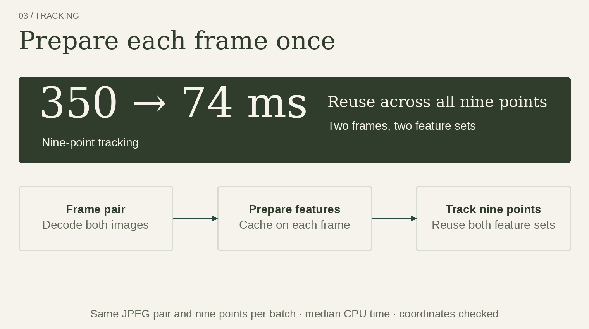

I’m working on a side project with Astra to build a physical product, and one thing I keep running into is how to report problems that only show up when I try to assemble the 3D-printed parts. OpenAI and Anthropic have both gotten better at generating a usable 3D model on the first try, but in my experience there’s always something to fix once I have the pieces in my hands.

My usual approach is to take a picture with my phone and give Astra a quick note so it can file a GitHub issue, which works fine until I need both hands to show what’s wrong. I wanted Astra to see what I was doing, steer me through the assembly, and take my verbal notes on what worked and what didn’t.

I already had two Tapo C210s that could pan and tilt, so I gave Astra control of both (why not, right?). For roughly $25 apiece, they have Wi-Fi, video, and two-way audio. I could keep holding the parts while Astra adjusted the angle, but every time it turned a camera it took another 2.4 seconds to see where it had landed.

This is the part I like about working with agents. I could just ask Codex to “fix it.” Our Python implementation opened the video stream, grabbed one frame, and closed it, so the next call had to do the whole thing again. Codex rewrote the server in Rust and left a reader running between calls, which brought the median down to 1.63 ms (for the latest frame already in memory, in case anyone is wondering what firmware I put on this thing).

We rebuilt the Python and Rust versions and timed 100 warm snapshot calls on each, using the same camera. ONVIF still handles the pan and tilt commands. The connection we kept opening and closing was RTSP, the one carrying the video. [Per-commit measurements](https://github.com/Belval/onvif-mcp/tree/main/benchmarks/commit-history)

## A second camera makes a decent test harness

Once we’d fixed image capture, I wanted a way to exercise the camera tool without sitting at my desk holding up a part every time we changed the code, so I came up with the I Spy protocol. The agent controlling Peek picked something in the room and kept its coordinates to itself. The agent controlling Seek then had to find it with the second camera and bring back a picture someone else could judge.

We ended up with seven independently judged games and 216 timed motion trials. The part I like about this setup is that Seek could edit the very tool it had just used, and on the next round we could check the picture as well as the timing. Cutting a wait is easy enough if nobody checks where the camera landed. [Trial records](https://github.com/Belval/onvif-mcp/tree/main/benchmarks/i-spy)

## What was left to speed up in Rust?

Take two images and ask the tracker where nine points went between them. All nine answers depend on features extracted from the same two images, and we were paying to extract those features again for each point. The agent attached the features to the frames that owned them, so after the first point the other eight could reuse the work.

On the same pair of test images, those nine answers took **74 ms instead of 350 ms**, and we checked that the coordinates agreed. The gain on a live preview call was smaller. Faster trace scanning and SIMD base64 encoding brought the median from **1.70 to 1.54 ms** over 600 requests per release, with tracing enabled and the agent’s thinking time excluded. [Benchmarks and raw traces](https://github.com/Belval/onvif-mcp/tree/ddc847f/benchmarks/mcp-optimization)

The assembly test I still care about is what happens after Astra asks me to turn a part over. It can now get another look without spending two seconds reconnecting to the camera. Whether it can look at what’s in my hand and give me the right next assembly step is a different experiment, and that’s the one I wanted the camera for in the first place.
