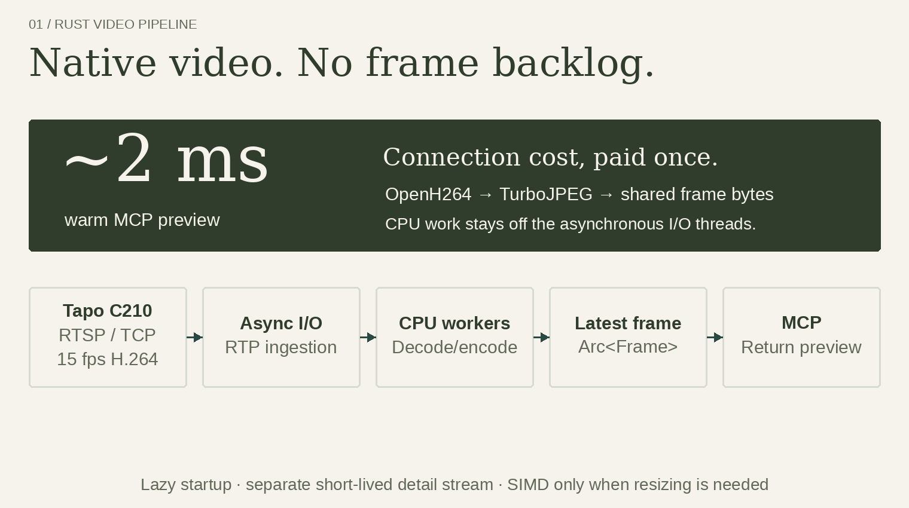
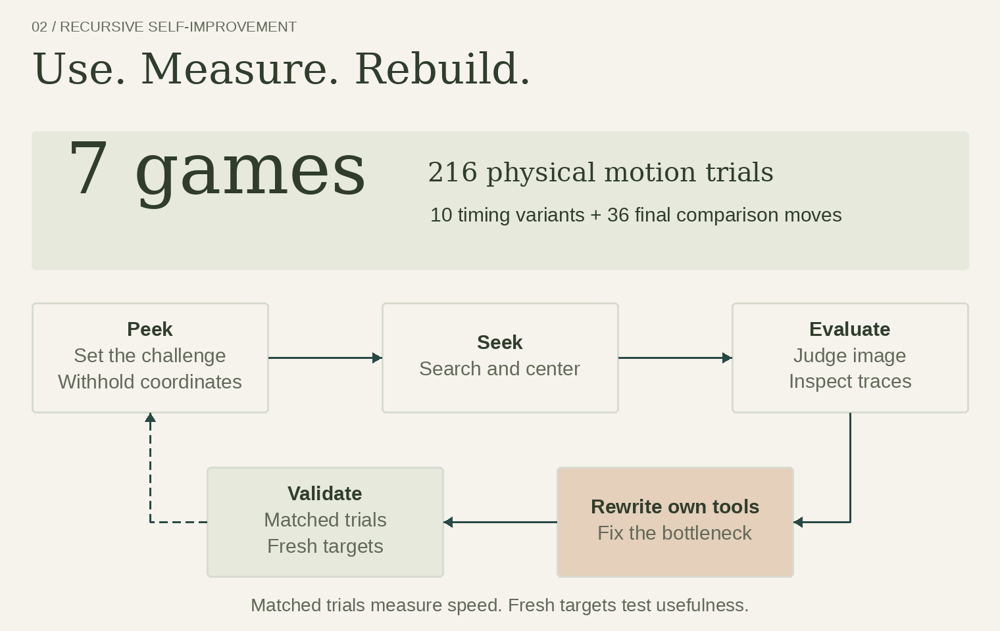

Once I’d 3D-printed the parts that Astra had designed, I wanted it to walk me through putting them together. It already knew how the pieces were supposed to fit, but if I held two of them up and asked whether I had one backwards, it would help considerably if it could see what I was holding. I had a Tapo C210 that could pan and tilt, so I gave Astra a camera tool and tried a simple test before getting any parts involved. Could it find the 3D printer in my office?

That was enough to turn up a problem I’d also have at the workbench. Every time Astra moved the camera to get a better angle, it had to wait another 2.4 seconds just to see where it had landed.

The useful number here is 15 fps, because it means the camera has another frame roughly every 67 ms whether the agent asks for one or not. Our Python implementation would open the stream, get one of those frames and close it, so the next call got to do all of that again. The agent rewrote the server in Rust and left a reader running between calls, which brought the median down to 1.63 ms (for the latest frame already in memory, in case anyone is wondering what firmware I put on this thing).

We rebuilt the Python and Rust versions and timed 100 warm snapshot calls on each, using the same camera. ONVIF still handles the pan and tilt commands. The connection we kept opening and closing was RTSP, the one carrying the video. [Per-commit measurements](https://github.com/Belval/onvif-mcp/tree/main/benchmarks/commit-history)

## A second camera makes a decent test harness

I wanted a way to exercise the camera tool without having to sit at the desk holding up a part every time we changed the code, so we had two agents play I Spy. Peek picked something in the room and kept the coordinates to itself, which meant Seek had to move its own camera and bring back a picture that somebody else could judge. Both cameras have googly eyes, a small hardware modification that makes having two of them looking around my office feel considerably less creepy.

We ended up with seven independently judged games and 216 timed motion trials. The part I like about this setup is that Seek could edit the very tool it had just used, and on the next round we could check the picture as well as the timing. Cutting a wait is easy enough if nobody checks where the camera landed. [Trial records](https://github.com/Belval/onvif-mcp/tree/main/benchmarks/i-spy)

## What was left to speed up in Rust?

Take two images and ask the tracker where nine points went between them. All nine answers depend on features extracted from the same two images, and we were paying to extract those features again for each point. The agent attached the features to the frames that owned them, so after the first point the other eight could reuse the work.

On the same pair of test images, those nine answers took **74 ms instead of 350 ms**, and we checked that the coordinates agreed. The gain on a live preview call was smaller. Faster trace scanning and SIMD base64 encoding brought the median from **1.70 to 1.54 ms** over 600 requests per release, with tracing enabled and the agent’s thinking time excluded. [Benchmarks and raw traces](https://github.com/Belval/onvif-mcp/tree/ddc847f/benchmarks/mcp-optimization)

The assembly test I still care about is what happens after Astra asks me to turn a part over. It can now get another look without spending two seconds reconnecting to the camera. Whether it can look at what’s in my hand and give me the right next assembly step is a different experiment, and that’s the one I wanted the camera for in the first place.
